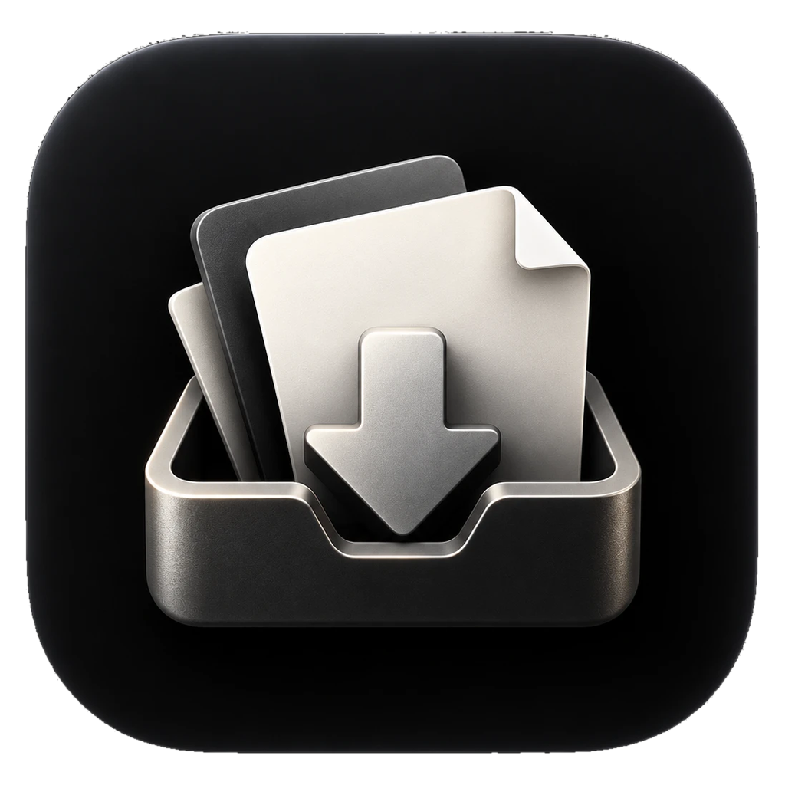

<p align="center"></p>

<h1 align="center">Eastape Downloader</h1>

<p align="center"><b>Made by Creators, for Creators</b><br>Download whole public Google Drive folders on Windows, with the same folder structure, a speed limit, and pause / resume.<br>Version 1.3 · © 2026 Eastape Tech. All rights reserved.</p>

---

## Features

- **Paste a link, press Scan.** Works with public folder links, file links, `open?id=` links and Google Docs / Sheets / Slides links. You can paste several links at once.
- **Same folders as on Drive.** Every subfolder is recreated on your PC, including empty ones.
- **Pick what to download.** Untick any file or folder before you start.
- **Speed limit, live.** 128 KB/s up to 100 MB/s, or unlimited. You can type an exact value, and changes apply immediately.
- **Files at once.** 1–8 parallel downloads, changeable while downloading.
- **Pause, Resume, Stop.** Unfinished files continue from where they stopped, even after closing the app.
- **Smart re-runs.** Files already downloaded are skipped.
- **Automatic retries** and a *Retry failed* button.
- **Google Docs, Sheets, Slides, Drawings** are saved as Office files or PDF.
- **Updates in one click.** The app checks for new versions and installs them itself; signed, so only Eastape Tech's updates are accepted.
- **News from Eastape** (announcements) right in the app.
- **Help & support** form inside the app; Terms, Privacy Policy, Disclaimer and open-source licences in Settings → Legal.

## Installing

Share **`EastapeDownloader-Setup-<version>.exe`**. The installer has a welcome page, Terms and Conditions (must be accepted), a choice of desktop shortcut, a folder picker, and an uninstaller in *Installed apps*. It installs for the current Windows user (in `%LOCALAPPDATA%\Programs`), so it needs no administrator rights and the app can update itself silently. It also:

- installs Microsoft Edge WebView2 if the PC doesn't have it;
- moves a version 1.1 installation (installed for all users) to the current user, keeping its settings and install ID; Windows asks once for permission to remove the old copy;
- refuses to overwrite the app while it is running and asks the user to close it.

`Setup.exe /S` installs silently; `/S /UPDATE` is what the in-app updater uses (waits for the app to close, then reopens it).

`EastapeDownloader.exe` alone also runs without installing (portable).

Because the files aren't code-signed yet, Windows SmartScreen shows "Windows protected your PC" when someone opens a downloaded installer: **More info → Run anyway**. Only a code-signing certificate removes that warning; the build already supports signing (`SIGN_CMD`, see below).

## Dashboard, stats, updates and support

- The **Eastape Downloader cloud** ([`web/`](web), on Vercel + Neon) receives installs, registrations, support messages and anonymous usage stats, offers updates and announcements, and has the **admin dashboard** (live users, downloads, data, versions, problems, support inbox, update publishing, announcements, team). See **[web/README.md](web/README.md)**.
- On first start a **welcome screen** walks new users through setup: **name and email are required**, with acceptance of the Terms, Privacy Policy and Disclaimer, and the app can't be used until it's done. When the terms change (`termsVersion` in `app.go`), existing users accept the new version once.
- Every installation, update and reinstall is reported once, even if the user never registers.
- Usage stats are always sent (since 1.3; disclosed in the Privacy Policy and Terms) and never include links, file names or files.
- Install notices, registrations and support messages can also be emailed through a private relay in your Google account ([server/apps-script/README.md](server/apps-script/README.md)); the receiving addresses live only in the relay's settings.
- Without a network the app keeps everything in an outbox and sends it later.
- Everything that is collected is listed in the Privacy Policy (`frontend/src/legal/privacy.md`). Change the policy if you change what is sent.

## Building

You need Go 1.23+, the Wails CLI (`go install github.com/wailsapp/wails/v2/cmd/wails@v2.10.2`) and NSIS (`makensis`). There's no npm step; the UI is plain HTML, CSS and JS in `frontend/src`.

```sh
# settings (once), files at the project root that git ignores:
#   cloud.env:  EASTAPE_APP_KEY=<APP_KEY of the cloud service>
#   relay.env:  EASTAPE_RELAY_URL=https://script.google.com/macros/s/.../exec   (optional email relay)
#               EASTAPE_RELAY_TOKEN=<same value as the RELAY_TOKEN script property>

./scripts/build-windows.sh            # → build/bin/EastapeDownloader.exe + EastapeDownloader-Setup-1.3.0.exe
go test -race ./internal/...          # tests
python3 scripts/gen-licenses.py       # refresh the open-source licences page after changing dependencies
python3 scripts/make-icons.py icon.png # new 1024x1024 icon → app icon, logos, favicons, installer art
```

GitHub Actions builds both files on every push (download them from the run's *Artifacts*). Add the repository secret `EASTAPE_APP_KEY` (and optionally `EASTAPE_RELAY_URL` / `EASTAPE_RELAY_TOKEN`) so those builds can talk to the service. Pushing a tag like `v1.3.0` attaches the files to a GitHub Release.

To ship an update to existing users, upload the new Setup in the dashboard (**Updates → New update**) and publish it.

**Code signing:** set `SIGN_CMD` to a script that signs the file passed as its argument (for example with `signtool sign /fd SHA256 /tr http://timestamp.digicert.com /td SHA256 /f cert.pfx /p ... %1`). The installer and uninstaller are then signed automatically.

## Project layout

| Path | What's there |
|---|---|
| `main.go`, `app.go` | Window setup and the methods the UI calls |
| `account.go` | Registration, install notices, support messages, diagnostics |
| `usage.go`, `updates.go` | Usage stats; update checks, the in-app updater and announcements |
| `internal/gdrive` | Link parsing, folder listing, download streams, exports |
| `internal/engine` | Download queue, parallel workers, speed limiter, pause / resume / stop |
| `internal/cloud` | Talking to the cloud service: event outbox, update check, signed update download |
| `internal/feedback` | Sending to the email relay, offline outbox |
| `internal/install` | Install ID and folder in the registry |
| `internal/settings`, `internal/power` | Preferences; keeping Windows awake |
| `frontend/src` | The UI; `frontend/src/legal` holds the legal documents |
| `build/windows/installer` | NSIS installer script and artwork |
| `server/apps-script` | The email relay to deploy in Google Apps Script |
| `web` | The cloud service and admin dashboard (Vercel + Neon) |
